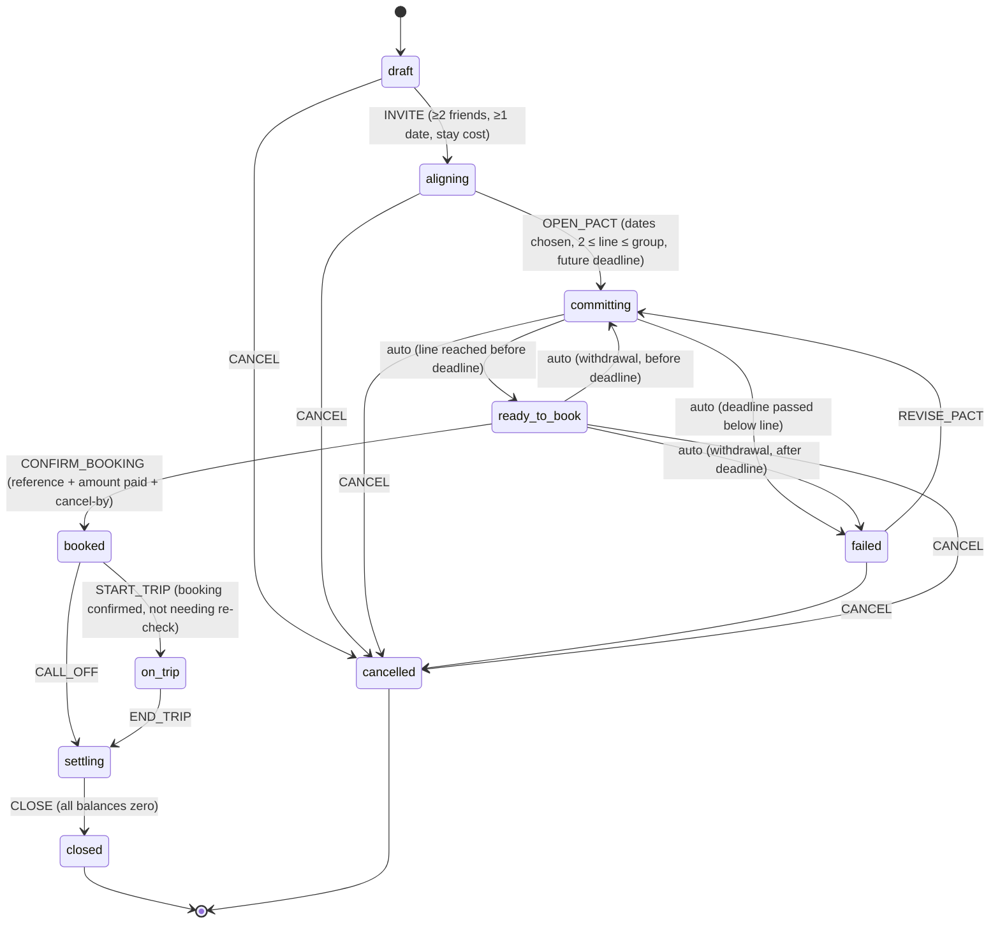

# Pakka v2

A friend-group trip only goes ahead, and money only moves, once enough people commit. v2 carries that commitment through the whole trip: dates and private budgets → the pact → booking → day plan → shared costs → settle-up → the next trip.

**Use it:** https://yashwanth-64.github.io/pakka/ (deployed from `main` by GitHub Actions). On a phone, open the link and choose *Add to Home Screen* / *Install app*: it opens full-screen like a native app and keeps working offline.
**Run it locally:** `npm run build`, then open `dist/pakka.html`, or serve `site/` (`npx serve site`) to test the installable version.

### Deploying

`.github/workflows/pages.yml` runs the unit tests, builds, and publishes `site/` to GitHub Pages on every push to `main`. One-time setup: in the repo go to **Settings → Pages → Build and deployment → Source** and pick **GitHub Actions**.

`npm run build` writes two things:
- `dist/pakka.html`: one self-contained file (no doctype, for the Artifact host).
- `site/`: the same app as a full web page plus `public/` (manifest, icons, offline service worker) for static hosting.
**Check it:** `npm run check` (unit + graph + SQL cross-check + end-to-end).

## Journey

| Tab | Stage | What connects downstream |
|---|---|---|
| Align | Group, date options, private budgets, rough costs | Chosen dates set nights/days, the cost forecast, stay search links and calendar dates |
| Commit | The pact: line, deadline, dropout rule (core moment kept from v1) | Reaching the line unlocks booking; falling back under it re-locks; deadline expiry offers recovery |
| Book | Search link-outs; booking recorded by hand with reference, amount and cancel-by | Creates the advance in the ledger, split across who committed; date changes flag it for re-check |
| Plan | Day-by-day items with map links and per-person costs | Costs feed the forecast; overlaps and out-of-range items are flagged; on the trip, items log as expenses |
| Money | One ledger: advance + trip costs + payments; fewest transfers to settle | Closing is blocked until everyone is settled; "plan again" seeds the next trip |

## Architecture

One store, one reducer, one graph. `src/model.js` holds the state shape, the phase graph (`EDGES` with guards), event permissions per phase, the reducer, derived selectors (forecast, budget fit, viability, balances, settlements, item flags, next actions) and `checkInvariants`. The UI (`src/app.js`) only dispatches events and renders selectors. Money is integer paise with exact splits.

Graph tests prove every phase is reachable, no non-terminal phase is a dead end, terminals have no exits, nothing reaches `cancelled` after money moved, and auto edges out of a phase are mutually exclusive. A seeded random walk (2,000 events across all presets) checks every invariant after every accepted event and that rejected events leave state untouched.

## Integrations

| Integration | Class | In this build |
|---|---|---|
| WhatsApp share (`wa.me/?text=`) | 1 · no credentials | Live: share invite and reminders; you pick the group |
| Google Maps URLs (`api=1`) | 1 · official, no key | Live: map per plan item, directions to destination |
| Google Calendar template link | 1 · works but undocumented by Google | Live; the Calendar API (class 2) needs Google sign-in |
| Airbnb / Booking.com search links | 4 · deep link, undocumented URL formats | Live; Airbnb has no open API/affiliate, Booking.com data needs a managed partnership |
| UPI | 3 · regulated | Pay-it-yourself + "I've paid"; P2P collect requests ended 1 Oct 2025; holding money needs a licensed payment aggregator |
| Google Photos | 4 · manual | Paste a shared-album link; apps lost shared-album access 31 Mar 2025 |
| Weather | 3 | Off: needs a server proxy and a commercial licence |
| Splitwise | 3 | Not needed: one internal ledger; commercial use needs Splitwise's approval |

The shared build declares no runtime capabilities, so anyone with the link opens it without permission prompts. Full sourcing: `reports/Friend trip app integrations India.md`.

## Tests (latest run)

- `npm test`: 27 passed (model scenarios, graph analysis + random walk, link formats)
- `npm run test:sql`: 6 presets loaded into SQLite with `docs/schema.sql`; balances, pact progress, budget fit and date tally match the app; constraint probes reject bad rows
- `npm run test:e2e`: 47 passed in headless Chromium (desktop + 390px phone, dark mode, reload persistence, invalid inputs, XSS)
- Bundle: 30.8 KB gzip JS (budget 80 KB)

## Known limitations

- Single-device demo: state lives in this browser. Real multi-user needs signed-in viewers and a shared store (schema in `docs/schema.sql`).
- Nothing external is automated: bookings, payments and messages are recorded by the people involved.
- Cost figures are illustrative estimates, not quotes. Evidence for demand and willingness to pay is not in this repo.
- `model.js` reducer is one large switch; splitting handlers per event is the next refactor if it grows.
